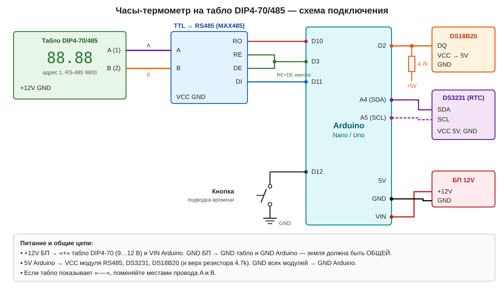

# Time — часы и термометр на табло DIP4-70/485

Arduino выводит на 4-разрядное табло **DIP4-70/485** (ООО «НТК Интерфейс») текущее время с модуля **DS3231**
и температуру с датчика **DS18B20**. Связь с табло — по RS-485 через модуль TTL↔RS485 (MAX485).

- **25 секунд** — время `ЧЧ.ММ` (точка мигает раз в секунду)
- **5 секунд** — температура `23.5°`, `-5.3°`, `-12°`
- Ручная подводка часов и минут **одной кнопкой**

## Схема подключения



Векторная версия: [docs/schematic.svg](docs/schematic.svg)

| Модуль | Вывод | Arduino |
|---|---|---|
| TTL-RS485 | RO | **D10** |
| TTL-RS485 | DI | **D11** |
| TTL-RS485 | DE + RE (соединить вместе) | **D3** |
| TTL-RS485 | VCC / GND | 5V / GND |
| TTL-RS485 | A / B | A (конт. 1) / B (конт. 2) RJ-11 табло |
| DS18B20 | DQ | **D2** + резистор **4.7 кОм** на +5V |
| DS3231 | SDA / SCL | **A4 / A5** |
| Кнопка | один вывод / другой | **D12** / GND (подтяжка внутренняя) |
| БП 12 В | +12V | «+» табло и VIN Arduino |
| БП 12 В | GND | GND табло и GND Arduino (**общая земля**) |

## Прошивка

Скетч: [`firmware/dip4_clock/dip4_clock.ino`](firmware/dip4_clock/dip4_clock.ino)

Библиотеки (Arduino IDE → Менеджер библиотек):
- **RTClib** (Adafruit)
- **OneWire**
- **DallasTemperature**

Настройки в начале скетча:

| Константа | По умолчанию | Назначение |
|---|---|---|
| `MODULE_ADDR` | `1` | адрес табло |
| `BRIGHTNESS` | `100` | яркость 0…125 |
| `TIME_SHOW_MS` | `25000` | сколько показывать время, мс |
| `TEMP_SHOW_MS` | `5000` | сколько показывать температуру, мс |
| `LONG_PRESS_MS` | `5000` | длительное нажатие кнопки, мс |
| `SET_TIMEOUT_MS` | `10000` | выход из настройки при бездействии, мс |
| `REVERSE_DIGITS` | `true` | поменять на `false`, если цифры идут задом наперёд |

## Подводка времени кнопкой (D12)

1. **Удерживать 5 с** → установка **часов** (часы мигают). Короткое нажатие — +1 час.
2. **Удерживать 5 с** → установка **минут** (минуты мигают). Короткое нажатие — +1 минута.
3. **Не нажимать 10 с** (или удерживать 5 с ещё раз) → время сохраняется в DS3231, секунды обнуляются.

Также время можно задать через монитор порта (9600, «Новая строка»):

```
set 2026 11 24 15 30 00
```

Если у DS3231 села батарейка, при запуске ставится время компиляции скетча.

## Протокол табло (кратко)

Полное описание — [docs/DIP4_manual.pdf](docs/DIP4_manual.pdf), Приложение 1.

```
02 | ADH ADL | COM | данные... | CRC | 03
```

- 9600 бод; байты `02`, `03`, `09` внутри посылки предваряются байтом `09` (байтстаффинг)
- CRC = инверсия суммы всех байт (кроме 02/03 и стаффинга) по модулю 256; `FF` — без проверки
- `0x1E` — 4 байта сегментов (бит0=a … бит6=g, бит7=точка), первый байт — правый разряд
- `0x2E` — вывод строки символами
- `0x17` (адрес `FFFF`) — яркость 0…125

## Диагностика

Если на табло горят тире `----`, табло не принимает посылки. Залейте
[`tools/dip4_test/dip4_test.ino`](tools/dip4_test/dip4_test.ino), откройте монитор порта (9600)
и посмотрите, на каком шаге табло реагирует. Проверьте:

- провода **A/B** (часто перепутаны — поменять местами)
- общий **GND** между БП табло и Arduino
- DE и RE модуля соединены и идут на D3
- RO → D10, DI → D11
